# Diagram2Code — Hand-Drawn Physics & Circuit Simulation Compiler

> **Hacktoberfest Hack Day Nagpur x Elevate IIITN — Qualifier Submission**
> **Track:** Track 2 — Best Use of Gemma 4
> **Problem Statement:** Multimodal Visual Reasoning & Executable Code Synthesis for STEM Tools

## Team Details

* **Team Name:** `The Infinite loops`
* **Team Leader:** Samarth Malviya ([@samdoescp](https://github.com/samdoescp))

---

## 1. Project Name

**Diagram2Code** — a local, privacy-preserving visual compiler that turns hand-drawn circuit and physics diagrams into executable simulation code.

## 2. Problem Statement

Engineers, educators and students routinely sketch technical systems, such as circuit schematics and free-body force diagrams, on paper or whiteboards. Turning these sketches into a working simulation means manually writing SPICE netlists or differential equations, which is slow and error-prone.

Existing OCR and vision tools treat a diagram as a generic image or a bag of text. They fail to capture the **graph structure** underneath: which components exist, how nodes connect, and what values and directions apply.

## 3. Project Overview

Diagram2Code takes a photo or scan of a hand-drawn diagram and produces three things: (1) a structured, editable description of the system, (2) a clean Python simulation script, and (3) live plots of the results. Everything runs locally on a normal laptop.

## 4. Proposed Solution

Diagram2Code is an edge-native visual compiler powered by **Google Gemma 4**. Instead of asking the model to write code straight from an image in one unpredictable step, the system splits the work in two:

1. **Gemma 4 (AI part):** reads the sketch and emits a strict JSON **Abstract Syntax Tree (AST)** with components, nodes, connections and values.
2. **Deterministic compiler (non-AI part):** converts the validated AST into Python code (`PySpice` for circuits, `SymPy` for physics) using fixed templates, then runs it in a sandbox.

This keeps the AI where it is strong (visual understanding) and keeps the code generation predictable and safe.

## 5. Objectives

* Extract components, connectivity and values from hand-drawn diagrams with a local open-weight vision model.
* Produce a validated, machine-readable AST as an intermediate representation.
* Compile the AST into correct, commented, standalone Python simulation code.
* Let the user review and correct the AST before any simulation runs.
* Render simulation results as interactive plots.
* Keep all processing offline so proprietary designs are never uploaded to a cloud service.

## 6. Target Users / Use Case

* **Electrical and mechanical engineers:** rapid offline prototyping of circuit sub-blocks and physical systems without launching heavy CAD software.
* **STEM educators and students:** instant checking of physics and electronics homework problems.
* **Privacy-constrained R&D teams:** local execution means circuit IP never leaves the machine.

**Example use case:** a student sketches an RC circuit, uploads a photo, checks the extracted components, and sees the capacitor charging curve within seconds.

## 7. Open-Source AI Technology Selected

| Component | Role |
|---|---|
| **Google Gemma 4** (open-weight vision-language model; exact variant chosen after testing on sample sketches) | Visual reasoning and AST extraction |
| **Ollama / llama.cpp** (4-bit/8-bit GGUF quantization) | Local inference runtime |

## 8. Why This Technology Was Selected

* **Multimodal input:** the task starts from an image, so a vision-language model is necessary. Plain OCR cannot recover connectivity.
* **Open-weight and local:** runs on consumer hardware, with no cloud API and no data leaving the device, which suits confidential engineering work.
* **Quantization support:** 4-bit GGUF builds make laptop-level inference practical.
* **Open approach:** the model can be swapped or fine-tuned later without redesigning the system, because the AST schema is independent of the model.

## 9. AI's Role in the System

Gemma 4 is the **visual reasoning engine** and acts only as an Intermediate Representation (IR) extractor:

1. **Visual topological extraction:** identifies component symbols (resistors, capacitors, sources, masses, force vectors) and maps connectivity across hand-drawn lines.
2. **Value normalization:** reads handwritten labels and engineering prefixes (e.g. $k\Omega$, $\mu\text{F}$, $N$) and converts them to standard units.
3. **Structured JSON emission:** outputs a strict AST that feeds the compiler.

The AI does **not** write the final simulation code, and it does not run anything.

## 10. System Architecture

```mermaid
flowchart LR
    A["Hand-drawn diagram (photo / upload)"] --> B["OpenCV preprocessing"]
    B --> C["Gemma 4 vision model (local, via Ollama)"]
    C --> D["Structured JSON AST"]
    D --> E["Pydantic schema validation"]
    E -->|invalid, retry| C
    E -->|valid| F["Human review and edit (Streamlit UI)"]
    F --> G["Template compiler"]
    G --> H["Python script: PySpice or SymPy"]
    H --> I["Sandboxed subprocess execution"]
    I --> J["Plotly graphs and downloadable .py file"]
```



## 11. Component-Level Architecture

| Component | Responsibility |
|---|---|
| **Web UI (Streamlit)** | Upload image, show extracted AST, allow manual edits, trigger simulation, display plots |
| **Preprocessor (OpenCV)** | Adaptive/Otsu thresholding, contrast adjustment, noise filtering, resize to 1024x1024 |
| **Vision engine (Gemma 4 via Ollama)** | Detect components, pins, values and net connections; emit JSON |
| **AST validator (Pydantic)** | Check schema, units, and basic rules (e.g. a circuit must contain a ground node) |
| **Domain compiler** | Map AST to `PySpice` netlist code (circuits) or `SymPy` equations (physics) |
| **Execution sandbox** | Run generated script in a resource-capped local subprocess with a timeout |
| **Visualizer (Plotly)** | Render waveforms and graphs |

## 12. Data / Information Flow

| Stage | Input Format | Processing Engine | Output Format |
| :--- | :--- | :--- | :--- |
| **Ingestion** | Raw photo / sketch upload | OpenCV thresholding and noise filtering | Cleaned 1024x1024 image |
| **Visual Inference** | Cleaned image | Gemma 4 vision-language model | Structured JSON AST |
| **Validation and Review** | JSON AST | Pydantic schema + user edits | Verified AST |
| **Code Generation** | Verified AST | Template compiler | Native Python script (`.py`) |
| **Simulation** | Python script | `PySpice` / `Ngspice` / `SymPy` / `SciPy` | Numerical results |
| **Visualization** | Numerical results | Plotly | Interactive graph / waveform |

**Example AST snippet:**

```json
{
  "domain": "circuit",
  "components": [
    {"id": "V1", "type": "voltage_source", "value": 5, "unit": "V", "nodes": ["n1", "0"]},
    {"id": "R1", "type": "resistor", "value": 1000, "unit": "ohm", "nodes": ["n1", "n2"]},
    {"id": "C1", "type": "capacitor", "value": 1e-6, "unit": "F", "nodes": ["n2", "0"]}
  ],
  "analysis": {"type": "transient", "duration_s": 0.01}
}
```

## 13. Agentic Workflow

The system is **not** a multi-agent framework. It uses a short, controlled loop so that behaviour stays predictable:

1. Gemma 4 extracts the AST.
2. The validator checks it. If it fails, the error message is sent back to the model for **one retry**.
3. The user confirms or edits the AST.
4. The compiler and sandbox run deterministically.

## 14. Technology Stack

* **AI engine:** Google Gemma 4 (open-weight vision model)
* **Inference runtime:** Ollama / `llama.cpp` (4-bit/8-bit GGUF)
* **Circuit and math engines:** `PySpice`, `Ngspice`, `SymPy`, `SciPy`
* **Image processing and validation:** OpenCV, Pydantic
* **Application and visualization:** Python 3.10+, Streamlit, Plotly

## 15. Expected Features

* Upload or capture a hand-drawn diagram.
* Automatic extraction of components, connections and values into an editable AST.
* Manual correction of the AST before simulation (human in the loop).
* One-click generation of a commented, standalone Python script.
* Live simulation with interactive graphs (transient response for circuits).
* Offline operation with no external API calls.

## 16. Implementation Approach

Scope is staged so a working demo exists early in the final hackathon, with extras added only if time remains.

* [x] **Stage 1: Qualifier (3–8 Oct)** — problem scope, architecture and AST specification; public repository containing only this README.
* [ ] **Stage 2: Vision to AST (core)** — set up Gemma 4 locally, write the system prompt that forces strict JSON, build the OpenCV preprocessing, and test on sample sketches.
* [ ] **Stage 3: Compiler (core)** — Pydantic schema, AST-to-`PySpice` templates for resistors, capacitors and DC sources, and pre-execution validation.
* [ ] **Stage 4: Sandbox and UI (core)** — subprocess sandbox with timeout, Streamlit app with AST editor and Plotly output.
* [ ] **Stage 5: Extensions (if time permits)** — `SymPy` module for free-body/kinematics problems, AC analysis and Bode plots.

## 17. Expected Final Output

1. **Interactive web app** where users upload a drawing, view and edit the extracted AST, and run a live simulation.
2. **Code generator** that outputs commented, standalone Python scripts (`PySpice` or `SymPy`) usable in Jupyter notebooks.
3. **Visualizer** showing circuit transient responses (and, as extensions, Bode plots and trajectory graphs).
4. A public repository with an open-source licence and run instructions.

## 18. Future Scope / Scalability

* **Low-resource deployment:** 4-bit quantization (Q4_K_M GGUF) lets the system run on consumer laptops without cloud GPUs.
* **Domain extensibility:** the AST JSON schema is a universal intermediate layer. New domains (digital logic gates, chemical kinetics) need only a new compiler module, not a retrained vision model.
* **Improving accuracy:** fine-tuning on a dataset of hand-drawn circuits, and learning from user corrections made in the AST editor.

## 19. Open-Source Dependencies / Components

| Dependency | Purpose |
|---|---|
| Google Gemma 4 | Vision-language model for AST extraction |
| Ollama / llama.cpp | Local quantized model inference |
| OpenCV | Image preprocessing |
| Pydantic | AST schema validation |
| PySpice + Ngspice | Circuit netlist generation and simulation |
| SymPy, SciPy, NumPy | Symbolic and numerical physics computation |
| Streamlit | Web interface |
| Plotly | Interactive plots |

## 20. Expected Challenges and Mitigation

| Risk Event | Impact | Mitigation |
| :--- | :--- | :--- |
| **Ambiguous hand-drawn node topology** | High: disconnected netlist or missing ground node | Human-in-the-loop AST editor to fix nodes before code generation; validator rule requiring a ground node |
| **Misread handwritten values or units** | High: wrong simulation results | Unit normalization, plausibility checks, and values shown in the editor for confirmation |
| **Malformed model output** | Medium: invalid JSON or code error | Strict JSON prompt, Pydantic validation, one retry with the error fed back |
| **Ngspice / PySpice setup problems** | Medium: simulation fails to run | Test the environment early; fall back to `SciPy`-based solvers for simple RC/RL circuits |
| **Too much scope for the final** | Medium: unfinished demo | Staged plan with a circuits-first core and physics as an optional extension |
| **Slow inference on laptops** | Low: latency during image parsing | Image downsampling and 4-bit GGUF quantization |

---

## License

*An appropriate open-source license (e.g. MIT) will be added to the repository during the final implementation phase.*
